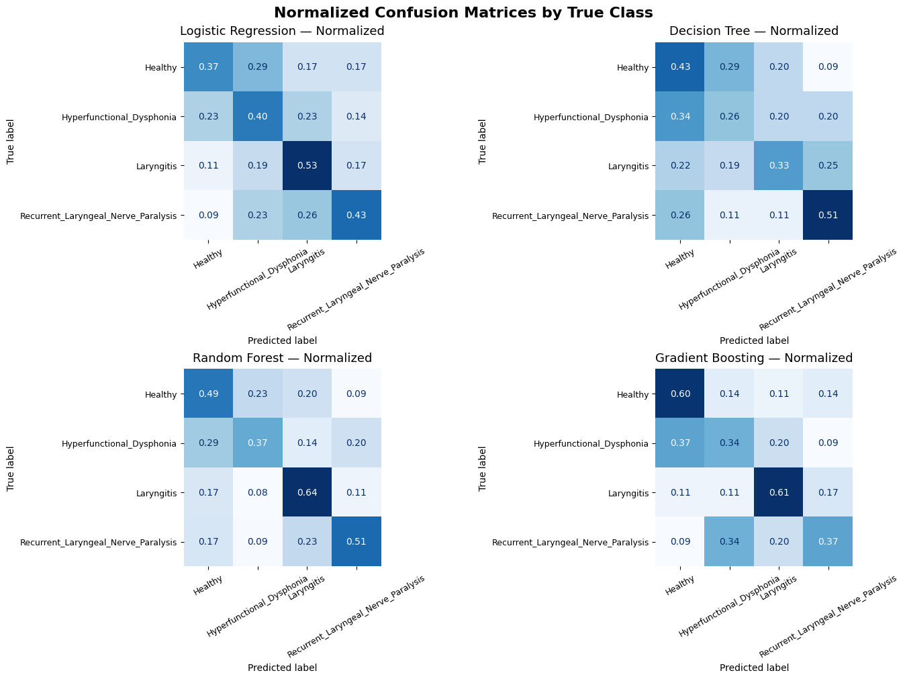
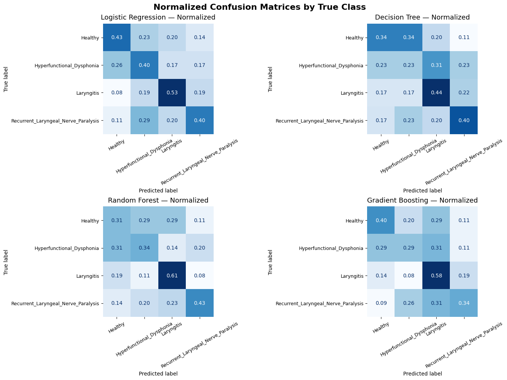

# Machine Learning for Voice Pathology Classification

**Biomedical Engineering · Artificial Intelligence & Machine Learning · Academic project (2025)**

An exploratory machine-learning study investigating whether **electroglottography (EGG)** and **neck-surface vibration (NSP)** recordings can support the classification of healthy and pathological voice signals. I developed preprocessing and acoustic-feature extraction pipelines, compared traditional classifiers, performed patient-level analyses, and investigated whether combining EGG and NSP features improves performance.

**Python · Librosa · scikit-learn · Biomedical signal processing · Machine learning · Feature extraction · Multimodal feature fusion**

> **Scope:** Four-class *academic research prototype*, not a validated clinical diagnostic tool. The highest reported held-out accuracy is **50.35%**—an improvement over individual modalities, but not adequate for clinical deployment.

## Research question

Can signal-processing features derived from vocal-fold contact (EGG) and neck-surface vibration (NSP) distinguish among:

1. Healthy voice
2. Laryngitis
3. Hyperfunctional dysphonia
4. Recurrent laryngeal nerve paralysis

The aim was to compare multiple modeling strategies and evaluate the practical value of complementary physiological and acoustic signals.

## Approach

**1. Signal preparation** — Inspect class/modality distributions, select balanced patient subsets, convert recording formats to WAV with FFmpeg, then preprocess the audio with Python and Librosa.

**2. Feature engineering** — Extract RMS energy, zero-crossing rate, mel-frequency cepstral coefficients (MFCCs), spectral centroid/flatness/bandwidth/roll-off, chroma, spectral contrast, and pitch-related descriptors.

**3. Model comparison** — Train and compare Logistic Regression, Decision Tree, Random Forest and Gradient Boosting. Evaluate held-out predictions using accuracy, balanced accuracy, macro-F1, and confusion matrices.

**4. Patient-aware analysis** — Use patient-wise train/test splits and, in later experiments, GroupKFold-based feature selection with SelectKBest and GridSearchCV. Aggregate recordings at patient level for the NSP and EGG+NSP analyses.

**5. Feature-level fusion** — Match patients across EGG and NSP tables and concatenate complementary features before classification. The notebook demonstrates *early / feature-level fusion*; the report also discusses score-level fusion conceptually, but a separate score-fusion implementation is not included in the supplied notebook.

**6. Local microphone prototype** — An optional demo records three short sustained-vowel samples and classifies them with a saved NSP model. It requires the trained model and suitable local audio hardware; it is **not** a web-based or clinically validated tool.

## Results

**Reported held-out test accuracy of the best model in each experiment** (transcribed from the supplied notebook; original results have not been rerun for this repository):

| Experiment | Best classifier | Test accuracy | Notes |
|---|---|---:|---|
| EGG — initial features | Gradient Boosting | 43.30% | Initial spectral/acoustic features |
| EGG — expanded features / selection | Random Forest | 44.22% | SelectKBest and GroupKFold tuning |
| NSP — patient-aggregated features | Logistic Regression | 43.97% | Neck-surface recordings only |
| **EGG + NSP — feature fusion** | **Random Forest** | **50.35%** | **Best overall in the project** |

The fused Random Forest model reported **50.26% balanced accuracy** and **49.96% macro-F1**. These figures indicate a modest improvement from combining complementary signal features, with considerable remaining classification error.

### Actual result figures

**EGG + NSP fusion — normalized confusion matrices (all four classifiers):**



**NSP-only experiment — normalized confusion matrices:**



Additional figures from all experimental stages are available in [`figures/`](figures/).

## Key findings

- EGG and NSP captured **complementary signal characteristics**; merging their feature sets improved the best reported test accuracy from approximately 44% to 50%.
- Class difficulty was uneven, with **hyperfunctional dysphonia particularly challenging** in several experiments.
- Patient-wise splitting and grouped cross-validation were used to reduce the risk of evaluating multiple recordings from the same patient across training and testing.
- More features or more complex classifiers did **not** consistently yield better results; data representation and evaluation design remained critical.
- An NSP-only, microphone-based demonstration was explored because EGG typically requires dedicated contact-measurement hardware.

## Repository structure

```text
voice-pathology-detection-machine-learning/
├── README.md
├── .gitignore
├── requirements.txt
├── notebooks/
│   └── voice_pathology_detection.ipynb
├── figures/
│   ├── egg-baseline-normalized-confusion.png
│   ├── egg-feature-selection-normalized-confusion.png
│   ├── nsp-normalized-confusion.png
│   ├── egg-nsp-fusion-normalized-confusion.png
│   └── ... four raw-count confusion-matrix plots
└── docs/
    ├── academic_report.pdf
    ├── DATA_SETUP.md
    ├── PORTFOLIO_COPY.md
    └── portfolio-preview.html
```

## Exploring and running the project

- **Read without running:** Open the [Jupyter notebook](notebooks/voice_pathology_detection.ipynb) directly on GitHub; key historical results and visualizations are retained.
- **Reproduce:** Obtain the original EGG/NSP datasets separately and read [dataset and environment setup](docs/DATA_SETUP.md). No patient recordings or training datasets are redistributed here.
- The notebook uses portable `VOICE_PATHOLOGY_DATA_DIR` and `VOICE_PATHOLOGY_OUTPUT_DIR` settings in place of the original local Windows/OneDrive paths. To use a microphone, manually set `RUN_LIVE_DEMO = True` only after training the NSP model.
- Original training and analysis logic is retained apart from the path changes, an added `subprocess` import, a corrected class-label display mapping, and disabling automatic microphone recording. **The cleaned version has not been end-to-end rerun.**

## Limitations and responsible use

- **50.35% accuracy on four classes is not clinically reliable.** No medical diagnosis or patient decision should be based on this prototype.
- Reported results reflect one academic dataset and experimental design; performance on new clinics, microphones, languages or recording conditions is unknown.
- Some exploratory preprocessing occurs outside model-training pipelines; a future version should audit all transformations for train/test leakage and perform fully nested cross-validation where applicable.
- The demonstration pads unavailable features with zeros and can use a microphone instead of the original NSP sensor. This is a **distribution mismatch**; its class probabilities should not be interpreted as calibrated clinical confidence.
- The notebook demonstrates feature-level fusion, **not a separately validated score-level fusion model**.
- Respect patient confidentiality, dataset terms, and licensing; do not upload raw recordings, identifiable metadata, or private data.

## Project materials

- [Original academic report (PDF)](docs/academic_report.pdf)
- [Code and historical outputs (Jupyter notebook)](notebooks/voice_pathology_detection.ipynb)
- [Data preparation instructions](docs/DATA_SETUP.md)
- [Portfolio presentation preview](docs/portfolio-preview.html)

---
**Author:** Carla Berard Gonzalez · BSc Biomedical Engineering
